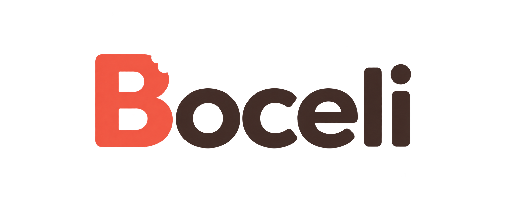
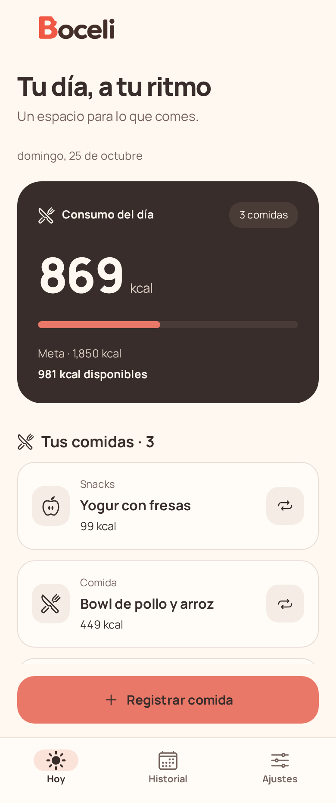
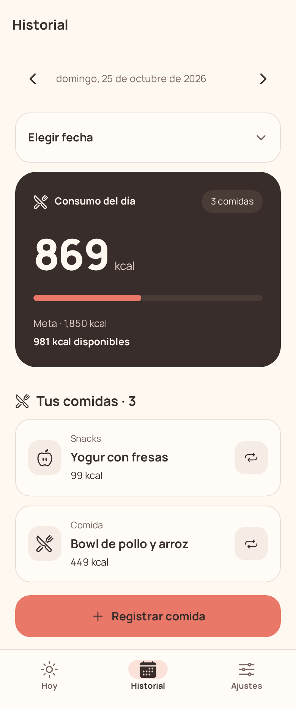
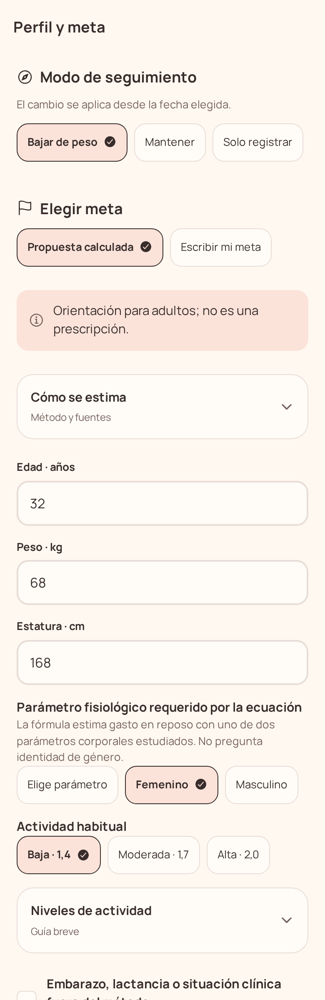
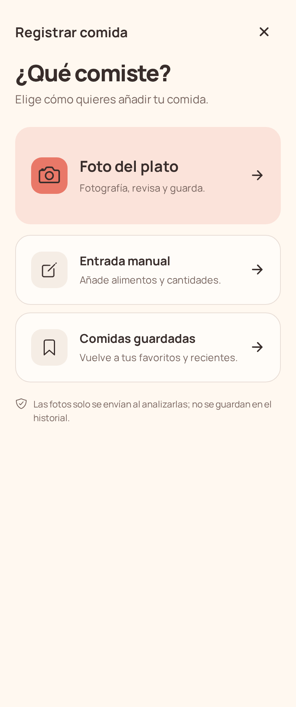
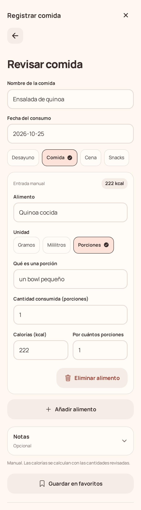
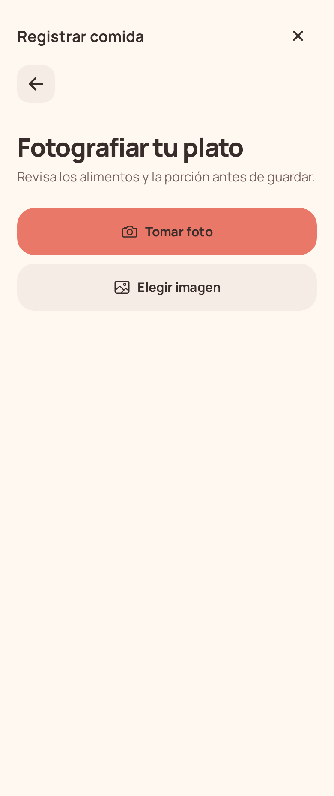
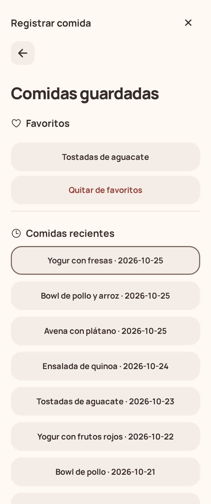
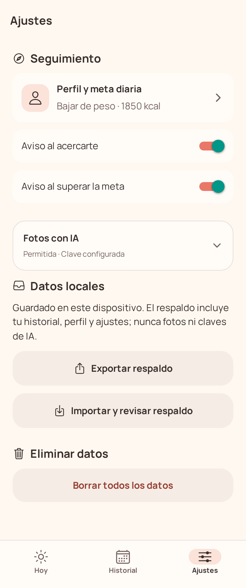
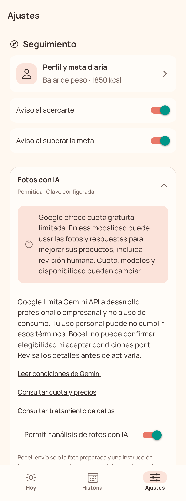

<div align="center">
  

  <p><strong>Un registro sencillo de tus comidas y calorías.</strong></p>
</div>

Boceli es una aplicación móvil para registrar comidas, revisar sus calorías y consultar el historial del día. Cada registro se guarda localmente en el dispositivo. Puedes añadir una comida manualmente, partir de una fotografía del plato con una estimación opcional de IA, o reutilizar una comida guardada.

La desarrollé para mi uso personal, como una herramienta sencilla para llevar mi propio registro de comidas. Sus funciones y evolución responden a mis necesidades cotidianas.

## Características

- Registro de comidas con cantidades, alimentos, notas y categorías.
- Estimación visual opcional de alimentos y porciones, editable antes de guardar.
- Historial diario y resumen de calorías.
- Comidas favoritas para reutilizar registros frecuentes.
- Meta manual, propuesta orientativa o modo «Solo registrar».
- Respaldo local exportable e importable.
- Interfaz en español y almacenamiento local, sin cuenta ni sincronización propia.

Las estimaciones son orientativas y no sustituyen información nutricional verificada ni consejo profesional. Consulta [la metodología y sus límites](docs/methodology.md).

## Tecnologías

| Área | Tecnología |
| --- | --- |
| Aplicación móvil | Expo SDK 58, React Native 0.88, React 19.3 y TypeScript |
| Navegación | Expo Router |
| Datos locales | SQLite con `expo-sqlite` |
| Clave de IA | `expo-secure-store` |
| Validación | Zod |
| Herramientas | Bun y ESLint |
| Análisis opcional de fotos | Gemini API |

## Requisitos

- Bun 1.4 o posterior.
- Node.js compatible: 22.13 o posterior en la serie 22; 24.3 o posterior en la serie 24; o 26 o posterior.
- Expo Go compatible con el SDK del proyecto, o un emulador/simulador configurado para desarrollo nativo.

## Instalación y desarrollo

```sh
bun install
bun start
```

Expo inicia Metro y muestra un código QR. Abre el proyecto con Expo Go compatible. También puedes iniciar directamente el destino configurado:

```sh
bun run android
bun run ios
```

La compatibilidad de Expo Go depende de la versión del SDK y de la plataforma. Si no hay una versión compatible para tu dispositivo, usa un emulador disponible o sigue la [guía de instalación y desarrollo](docs/installation.md) para preparar un desarrollo nativo.

Comprobaciones y exportación:

```sh
bun run typecheck
bun run lint
bun run check
bun run export:native
```

`export:native` genera los bundles de JavaScript para iOS y Android. No firma ni produce instaladores IPA o APK.

## Análisis opcional de fotos

El análisis requiere una clave propia de Gemini, habilitar el permiso en Ajustes y aceptar las condiciones del proveedor. La clave se guarda en el almacenamiento seguro del dispositivo. Boceli envía a Google la foto preparada y las instrucciones del análisis; no envía el perfil corporal ni el historial. La propuesta se puede revisar antes de guardar.

El proveedor puede tratar los datos según las condiciones de la cuenta y el nivel de servicio. Revisa [privacidad, IA y servicios externos](docs/privacy-and-ai.md) antes de activar esta función. No incluyas claves en el repositorio.

## Datos y privacidad

Perfil, metas, comidas, alimentos y favoritos se guardan en SQLite local. Boceli no ofrece cuentas, sincronización, telemetría ni analítica propia. Las fotos preparadas se usan durante el flujo de revisión y no se añaden al historial ni al respaldo.

Desde Ajustes puedes exportar o restaurar un respaldo JSON. El archivo contiene datos del perfil y del historial: mantenlo privado. Restaurar reemplaza los datos locales después de validar el archivo y pedir confirmación; el respaldo no contiene claves ni consentimiento de IA. **Borrar todos los datos** elimina el contenido local y la clave guardada.

## Capturas

Las pantallas se muestran con datos ficticios.

<div align="center">
  
  
  
</div>

<div align="center">
  
  
  
</div>

<div align="center">
  
  
  
</div>

## Documentación

- [Instalación y desarrollo](docs/installation.md)
- [Privacidad, IA y servicios externos](docs/privacy-and-ai.md)
- [Metodología de calorías y límites](docs/methodology.md)

## Contribuciones

Consulta [la guía de contribución](CONTRIBUTING.md) para reportar problemas o proponer cambios. Al ser un proyecto personal, se priorizan los cambios pequeños que mantengan su sencillez.

## Licencia

Este proyecto se distribuye bajo la [licencia MIT](LICENSE). Los componentes de terceros conservan sus respectivas licencias.
